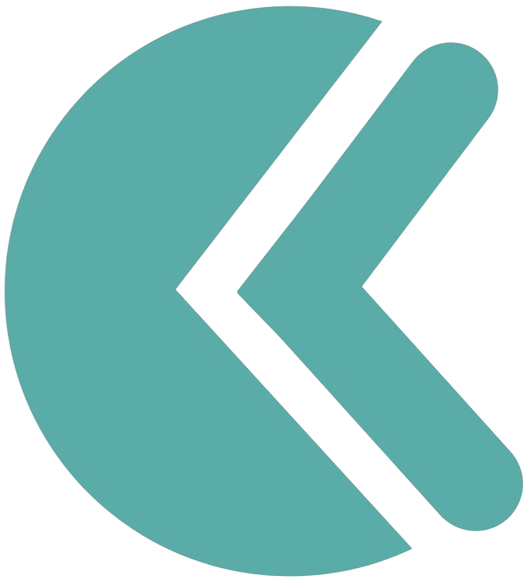
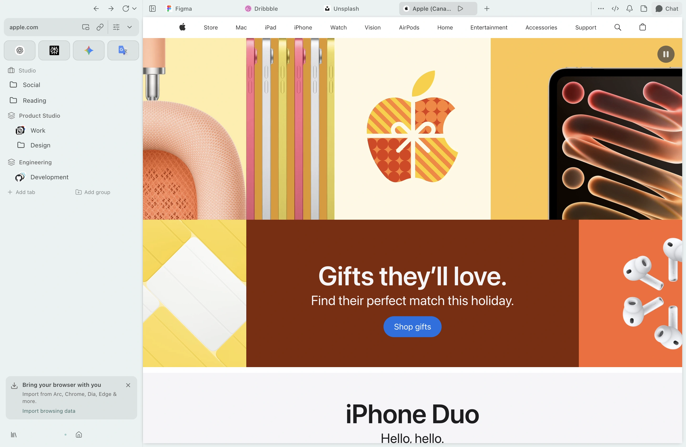
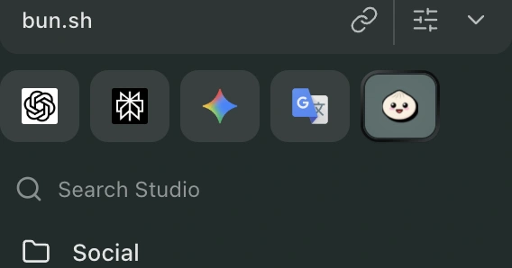
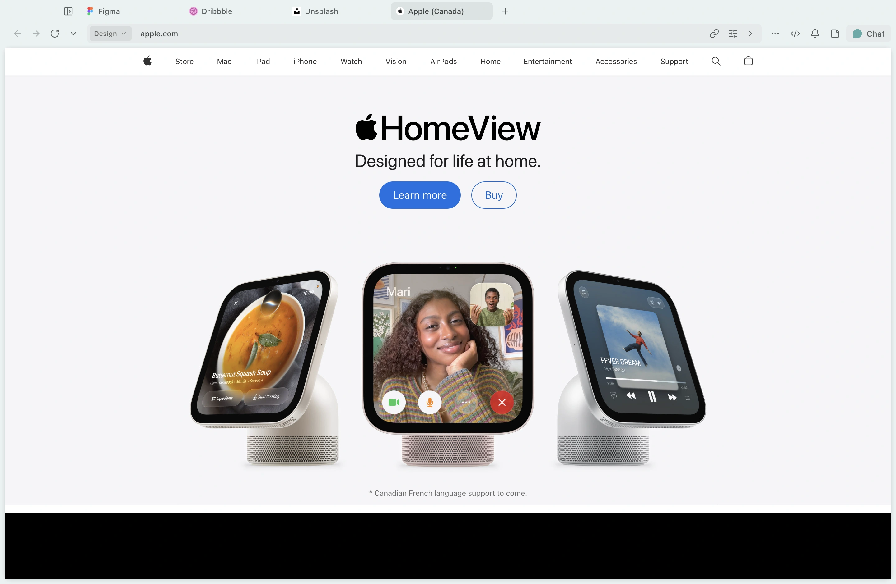
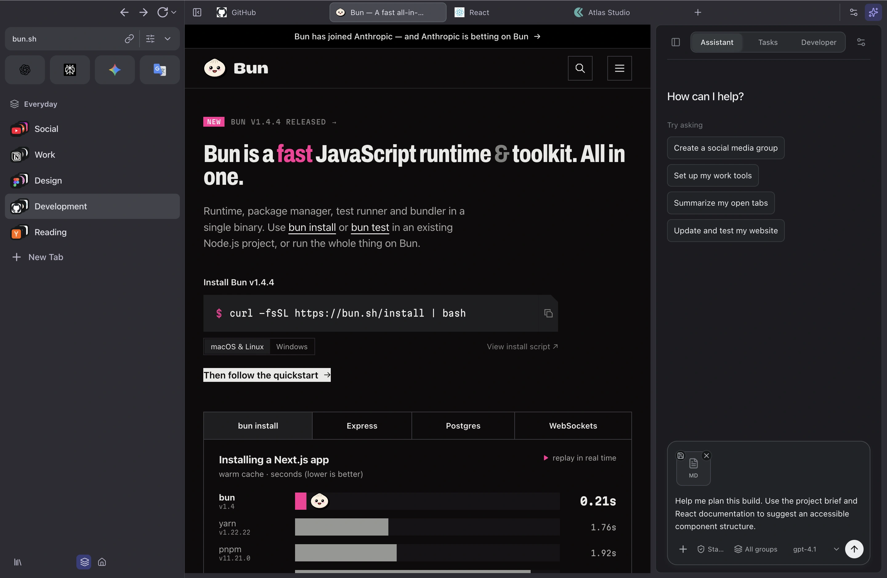
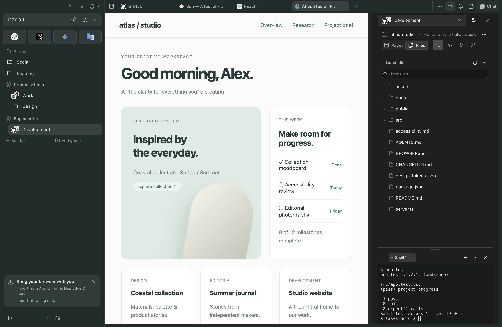

# Kudium Browser

**Your tabs. Your projects. One workspace.**

Kudium Browser brings everyday websites, separate accounts, AI assistance, and local
project tools into a desktop browser. Give work, personal browsing, and each project
their own space, then keep the pages and tools you need together.

[Get Browser for Apple Silicon](https://browser.kudium.com/download/darwin/arm64) ·
[Get Browser for Intel Mac](https://browser.kudium.com/download/darwin/x64) ·
[Explore the website](https://browser.kudium.com) ·
[Learn with tutorials](https://browser.kudium.com/tutorials)



## A workspace that follows what you are doing

A design project might need Figma, inspiration, and a client portal. Development
might need documentation, a local preview, source files, and a terminal. Personal
browsing might need another set of accounts entirely. Kudium gives each of these a
home you can return to.

| What you need | How Kudium keeps it together |
| --- | --- |
| Separate work, personal browsing, and projects | **Spaces and tab groups** organize your pages. Separate browser sessions let you keep different accounts open side by side. |
| Tools you reach for every day | **Favorites** stay within reach across Spaces. **Pinned groups** keep recurring work easy to find inside its Space. |
| More room for the page | **Collapse the sidebar** and use the **group picker in the address bar** to switch contexts. |
| Help with the page or project in front of you | The **AI sidebar** keeps your page visible while you bring selected browsing context and file references into a conversation. |
| A place to build as well as browse | **Link a local project** to a group and work with its file manager, editor, scripts, and terminal beside your web pages. |

## Keep your everyday tools close

Favorites are for tools you use across contexts. Pinned groups are for the work
that belongs in a particular Space. Keep your assistant tools at the top and give
Social, Work, Design, Development, and Reading their own groups below.



[Set up Favorites and pinned groups](https://browser.kudium.com/tutorials/favorites-and-pinned-groups)

## Focus without losing your place

Hide the sidebar when you want the web page to take the stage. The current group
stays in the address bar, so switching groups does not require reopening the sidebar.



[Use the sidebar and address-bar group picker](https://browser.kudium.com/tutorials/sidebar-and-group-picker)

## AI beside your pages and projects

Keep the page in view while you ask questions, plan a change, or bring a project
brief into the conversation. Use the built-in assistant with your own model API
key, or connect an external AI client through MCP. Choose the scope and approval
mode for browser actions in Preferences.



[Use the AI assistant](https://browser.kudium.com/tutorials/ai-assistant) ·
[Understand access and approvals](https://browser.kudium.com/tutorials/ai-permissions)

## Your local project belongs in the workspace

Connect a local folder to your development group. Keep documentation and a live
preview alongside the tools that act on that same project:

- **File manager and editor:** browse folders, filter by filename, edit source, and save changes.
- **Terminal tabs:** run commands from your project directory and keep output next to the browser.
- **Project scripts:** give repeatable commands a name and a working directory.
- **Developer tools:** inspect web pages with DevTools and configure website hooks and styles.



[Connect a project](https://browser.kudium.com/tutorials/developer-project) ·
[Explore the file manager](https://browser.kudium.com/tutorials/file-manager) ·
[Use the terminal](https://browser.kudium.com/tutorials/project-terminal)

## Try it, then make it yours

Public Mac downloads are signed and notarized for Apple Silicon and Intel.
Windows and Linux can be built from source using the local packaging instructions.
Start with [your first workspace](https://browser.kudium.com/tutorials/first-workspace),
then explore [preferences](https://browser.kudium.com/tutorials/preferences),
[appearance](https://browser.kudium.com/tutorials/appearance), and
[separate logins](https://browser.kudium.com/tutorials/spaces-and-groups).

The screenshots are the same real Kudium UI captures used on the website, with
public websites and an Atlas Studio demo project. The AI scene shows a draft with
an attached brief; the terminal scene shows an actual test run.

## Repository layout

This repository contains the Electron + React desktop browser and its standalone
Bun + Hono web service. Each application keeps its own dependencies, lockfile,
build, and deployment configuration. The backend serves the showcase, tutorials,
and update feeds, with Better Auth and PostgreSQL/Drizzle encrypted-record sync.
Desktop account connection and encryption-key enrollment remain separate work.

```text
apps/
  browser/    Electron + React desktop browser (npm)
  web/        Bun + Hono + Better Auth + PostgreSQL/Drizzle service (Bun)
```

- [Browser development, local builds, and cleaning](apps/browser/README.md#develop-kudium-browser)
- [Web service setup and API documentation](apps/web/README.md)
- [Build and release pipeline](docs/build-and-release.md)
- [Deploy browser.kudium.com](apps/web/deploy/README.md)

## Start development

Run these commands from the monorepo root, in separate terminals:

```sh
npm run dev:browser
npm run dev:web
```

The web app requires an untracked `apps/web/.env` configured from
`apps/web/.env.example`. For local development use
`BETTER_AUTH_URL=http://localhost:3000`. Generate a persistent Better Auth secret,
configure PostgreSQL and run `npm run db:migrate` before starting it.

## Install and check

```sh
npm run install:browser
npm run install:web
npm run check:web
npm run test:web
npm run test:browser -- --runInBand
npm run build:browser
```

Browser requirements and native build steps are in its README. The web app runs on
Bun. Commands can also run directly inside each app's directory. Dependencies remain
app-local; run installs through the app-specific commands above.

Set `TEST_DATABASE_URL` to a dedicated PostgreSQL test database when running the web
integration tests. Without it, those tests are explicitly skipped.

`npm run package:browser` packages the browser with its existing GitHub update feed.
`npm run package:web` packages the browser with the feed at
`https://browser.kudium.com`. The name refers to the update provider; the web
service itself deploys from `apps/web/Dockerfile` or `apps/web/compose.yaml`.

The web backend supports Better Auth sessions, encrypted sync records and update
feeds. Desktop account connection and encryption-key onboarding remain separate
work. Deployment instructions and current limitations live with the web app.

## Local desktop installers

See the browser README for [macOS, Windows and Linux build commands](apps/browser/README.md#packaging-locally)
and [cleaning generated output](apps/browser/README.md#output-and-cleaning).
Local packaging does not publish a stable or beta release.
