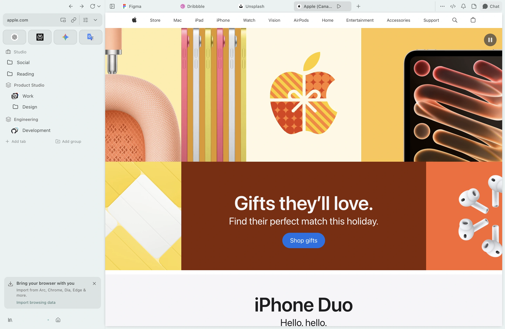
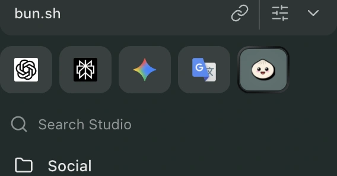
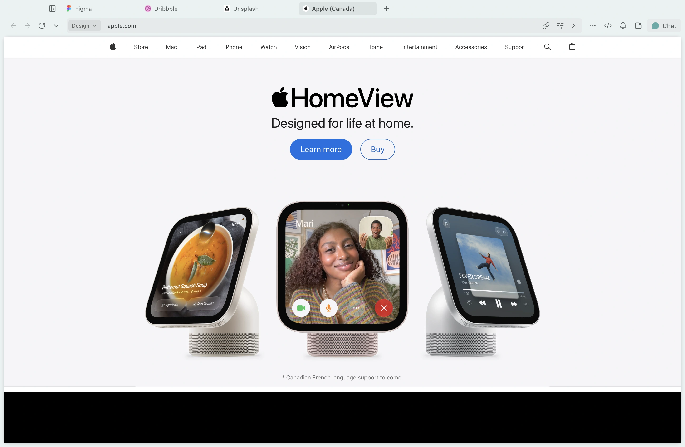
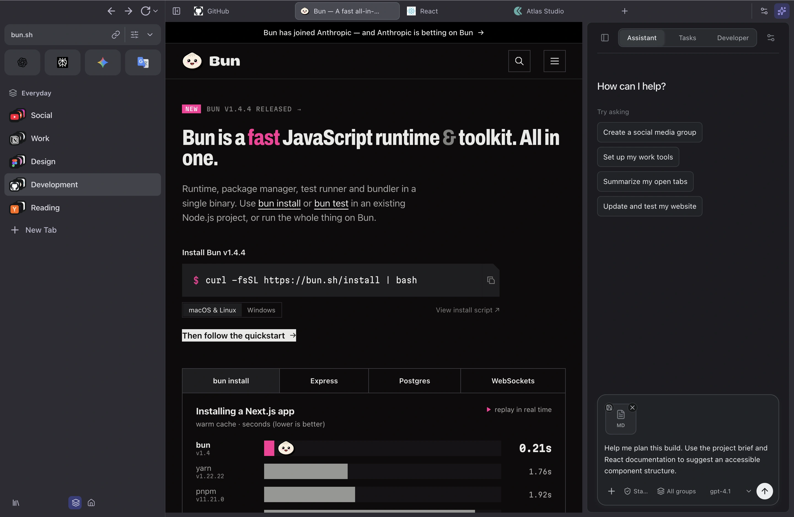
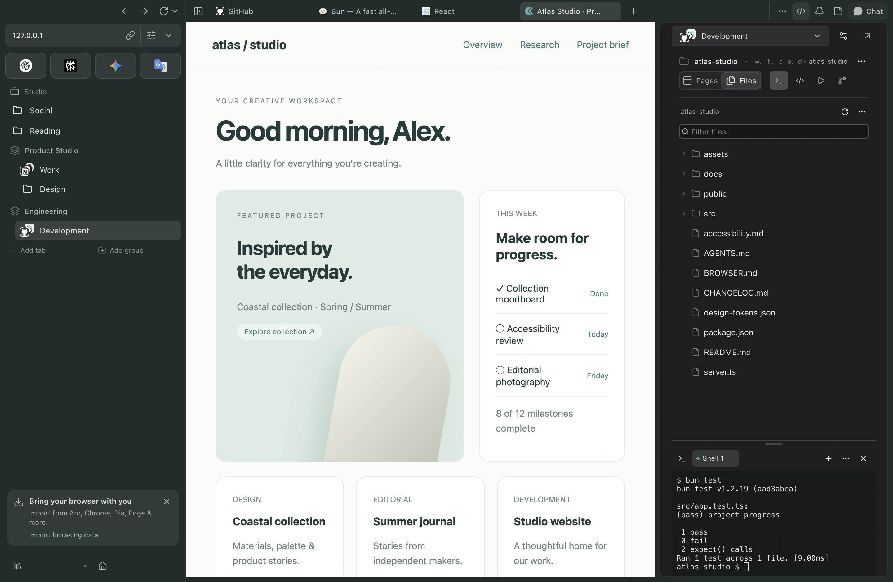

# Kudium Browser

**Your tabs. Your projects. One workspace.**

Kudium Browser brings everyday websites, separate accounts, AI assistance, and local
project tools into a desktop browser. Give work, personal browsing, and each project
their own space, then keep the pages and tools you need together.

[Get Browser for Apple Silicon](https://browser.kudium.com/download/darwin/arm64) ·
[Get Browser for Intel Mac](https://browser.kudium.com/download/darwin/x64) ·
[Explore the website](https://browser.kudium.com) ·
[Learn with tutorials](https://browser.kudium.com/tutorials)



## A workspace that follows what you are doing

A design project might need Figma, inspiration, and a client portal. Development
might need documentation, a local preview, source files, and a terminal. Personal
browsing might need another set of accounts entirely. Kudium gives each of these a
home you can return to.

| What you need | How Kudium keeps it together |
| --- | --- |
| Separate work, personal browsing, and projects | **Spaces and tab groups** organize your pages. Separate browser sessions let you keep different accounts open side by side. |
| Tools you reach for every day | **Favorites** stay within reach across Spaces. **Pinned groups** keep recurring work easy to find inside its Space. |
| More room for the page | **Collapse the sidebar** and use the **group picker in the address bar** to switch contexts. |
| Help with the page or project in front of you | The **AI sidebar** keeps your page visible while you bring selected browsing context and file references into a conversation. |
| A place to build as well as browse | **Link a local project** to a group and work with its file manager, editor, scripts, and terminal beside your web pages. |

## Take a tab into its own window

Drag a horizontal tab out onto the desktop to open it in a temporary, unpinned
group. The tab leaves its original group and keeps the same live page, cookies,
login session, form input, scroll position, and playback. Closing that temporary
window dismisses its tabs; drag the tab or group back onto the main sidebar or
tab strip to keep it in the main workspace. Dropping onto its parent group restores
its original membership. Dropping onto a group with another login profile creates
a separate group with the original session, so the tab stays signed in.

Drag a sidebar group out to open the whole group in another window. Its saved
group remains available in the main workspace. When both windows select the same
tab, the inactive window shows a subtly dimmed preview. Focusing it moves the live
page back into that window without reloading. Independent tabs and login profiles
remain independent.

Use **Command+N** on macOS or **Ctrl+N** on Windows and Linux for another browser
window, or choose **File → New Window**. Customize the binding in
**Preferences → Keyboard shortcuts**. Tab and group context menus also provide
**Open tab in new window** and **Open group in new window**. Press Escape to cancel
a drag. Each window keeps its own selected tab and Space.

## Watch while you work

Play a video and click **Picture in picture** in the address bar to open the
native floating player. With multiple videos, Kudium chooses the largest playing
video. You can also right-click a supported video and choose **Picture in Picture**
to open that specific player, including an embedded player.

The video stays above your other windows when you switch tabs. Click the address-bar
button again from its source tab, or close the floating player, to return it to the
page. The shortcut stays available while a floating video is paused. Website PiP
restrictions are respected; unsupported videos do not show the action.

## Keep your everyday tools close

Favorites are for tools you use across contexts. Pinned groups are for the work
that belongs in a particular Space. Keep your assistant tools at the top and give
Social, Work, Design, Development, and Reading their own groups below.



[Set up Favorites and pinned groups](https://browser.kudium.com/tutorials/favorites-and-pinned-groups)

## Focus without losing your place

Hide the sidebar when you want the web page to take the stage. The current group
stays in the address bar, so switching groups does not require reopening the sidebar.



[Use the sidebar and address-bar group picker](https://browser.kudium.com/tutorials/sidebar-and-group-picker)

## AI beside your pages and projects

Opening Chat, returning from another assistant page or selecting a conversation
scrolls to its latest messages. Scrolling upward pauses automatic following so new
messages do not interrupt reading. After a production build, run
`npm run test:chat-scroll` from `apps/browser` for the native regression with
disposable conversation history; screenshots and results stay under `release/`.

Keep the page in view while you ask questions, plan a change, or bring a project
brief into the conversation. Use the built-in assistant with your own model API
key, or connect an external AI client through MCP. Choose the scope and approval
mode for browser actions in Preferences.



[Use the AI assistant](https://browser.kudium.com/tutorials/ai-assistant) ·
[Understand access and approvals](https://browser.kudium.com/tutorials/ai-permissions)

## Your local project belongs in the workspace

Connect a local folder to your development group. Keep documentation and a live
preview alongside the tools that act on that same project:

- **File manager and editor:** browse folders, filter by filename, edit source, and save changes.
- **Terminal tabs:** run commands from your project directory and keep output next to the browser.
- **Project scripts:** give repeatable commands a name and a working directory.
- **Developer tools:** inspect web pages with DevTools and configure website hooks and styles.



[Connect a project](https://browser.kudium.com/tutorials/developer-project) ·
[Explore the file manager](https://browser.kudium.com/tutorials/file-manager) ·
[Use the terminal](https://browser.kudium.com/tutorials/project-terminal)

## Try it, then make it yours

Public Mac downloads are signed and notarized for Apple Silicon and Intel.
Windows and Linux can be built from source using the local packaging instructions.
Start with [your first workspace](https://browser.kudium.com/tutorials/first-workspace),
then explore [preferences](https://browser.kudium.com/tutorials/preferences),
[appearance](https://browser.kudium.com/tutorials/appearance), and
[separate logins](https://browser.kudium.com/tutorials/spaces-and-groups).

The screenshots are the same real Kudium UI captures used on the website, with
public websites and an Atlas Studio demo project. The AI scene shows a draft with
an attached brief; the terminal scene shows an actual test run.

## Develop Kudium Browser

## Requirements

- Node.js 22.12 or newer
- npm 10 or newer

## Development

From the monorepo root, run `npm run dev:browser`. The commands below run from
`apps/browser`.

```bash
npm install
npm run dev
```

The development command starts the renderer server, watches the Electron main
process and preload bundle, and opens the Kudium Browser window.
`npm start` also runs the same development workflow. Renderer components use
React Fast Refresh; main-process changes restart Electron, and preload changes
reload the window.

## Quality checks

The [browser completeness checklist](../../docs/browser-completeness.md) tracks
compatibility, protection, recovery and everyday browser improvements with
acceptance criteria and verified progress.

Run the native compatibility baseline from the repository root:

```sh
npm run build:browser
npm run test:browser:compatibility
```

It uses disposable profiles and local pages to check browser identity, login
isolation, service workers, storage, WebCrypto, multipart uploads and live updates.
It also checks OAuth-style popup returns, a download interrupted by actual process
termination, live HTTP byte-range resume, independent camera/microphone decisions
with fake devices, the real source-picker UI with synthetic sources, and Chromium
file-input selection. The macOS Open/Save sheets are
separate checks. Reports are saved under
`apps/browser/release/local-compatibility-<timestamp>/`.
An existing Electron Node-mode environment variable is removed for the child app.
These checks do not certify real provider sign-ins, device permissions or DRM.

The default website identity preserves the installed Chromium and Electron
versions. Removing the Electron token makes Google choose a sign-in flow that
rejects this browser host. Only Kudium's app product token is removed; the same
identity policy applies to every website, frame and worker.

Run `npm run test:browser:sign-in` from the repository root for optional network
checks of Google's compatible sign-in entry and WhatsApp's linking page, using
the production backend with disposable profiles. `KUDIUM_SIGNIN_EMAIL` optionally
tests Google's account identifier step. Reports omit the email and sign-in tokens.
This command stops before authentication; successful account sign-in needs a
separate user-assisted check.


```bash
npm run lint
npm test
```

`lint` checks code style and TypeScript types. `npm test` runs unit tests in the
background without opening Electron or taking focus. Each command stops on the
first failure. Arguments go to ESLint or Jest respectively; for example,
`npm run lint -- --fix` and `npm test -- --runInBand`.

Use `npm test -- --desktop` to also build the app and run the Electron desktop
smoke test. This explicitly enabled test opens windows and takes focus to check
native keyboard shortcuts. It uses a disposable profile. You can combine flags,
for example, `npm test -- --desktop --runInBand`.

For an existing macOS package built from current production bundles, run
`npm run test:packaged-security -- "/absolute/path/Kudium Browser.app"`. This checks the
actual fuse settings, disposable default/hardened attack fixtures, and basic
packaged Chromium port/pipe restrictions. A test-only ASAR observer checks the
production UI payload, website isolation, CSP and history persistence without
a production debugging exception. It does not verify
release signing or other platforms. See
[packaged security evidence](docs/benchmarks/packaged-debugging-2026-11-07.md).

## Command reference

| Command           | What it does                                                                                                                          |
| ----------------- | ------------------------------------------------------------------------------------------------------------------------------------- |
| `npm run dev`     | Starts the renderer server, watches the main process and preload bridge, and opens Electron with hot reload. Ctrl+C stops everything. |
| `npm start`       | Alias for `npm run dev`.                                                                                                              |
| `npm run build`   | Compiles production bundles into `release/app/dist`.                                                                                  |
| `npm run package` | Cleans production output, builds the app, and creates a local installer in `release/build`. It does not publish a release.            |
| `npm test`        | Runs unit tests in the background. Add `-- --desktop` for the build and desktop smoke test.                                           |
| `npm run lint`    | Runs ESLint and TypeScript checks without creating a build.                                                                           |

These are the six supported commands. Cleaning is part of packaging, type
checking is part of linting, and desktop testing is available through `npm test -- --desktop`.

Packaging prepares native dependencies for the selected Electron version and
architecture. Dependency installation applies the browser’s integration patches;
a separate rebuild command is not required for the local packaging flow below.

## Packaging locally

Run the following commands from `apps/browser`. Local packaging creates installers
on your computer; it does not upload them or change the public update feeds.
Local builds use the checked-in package versions. Automatic version calculation
runs in the GitHub release workflow.

### Build prerequisites

Use Node.js 24.15.0 and npm 12.2.0 to match CI, then install dependencies:

```sh
cd apps/browser
npm ci
```

Build on the operating system you are targeting. The documented local targets are
macOS Apple Silicon and Intel, Windows x64, and Linux x64. Windows and Linux ARM
installers are not currently part of the release pipeline.

| Host OS | Native build prerequisites | Installer output |
| --- | --- | --- |
| macOS | Xcode Command Line Tools, including `xcrun`, Swift and the macOS SDK. Install with `xcode-select --install`. | `.dmg` and `.zip` |
| Windows | Python 3 and Visual Studio Build Tools with the Desktop development with C++ workload if native modules need compilation. Use PowerShell for the commands below. | NSIS `.exe` |
| Linux | Python 3, `make` and a C/C++ compiler for native modules. On Debian/Ubuntu, install `python3` and `build-essential`. Building and running Electron requires a compatible Linux environment. | `.AppImage` |

### macOS

Build for Apple Silicon:

```sh
CSC_IDENTITY_AUTO_DISCOVERY=false npm run package -- --mac --arm64
```

Build for Intel:

```sh
CSC_IDENTITY_AUTO_DISCOVERY=false npm run package -- --mac --x64
```

To retain both architectures in the same output folder, build them in one command:

```sh
CSC_IDENTITY_AUTO_DISCOVERY=false npm run package -- --mac --arm64 --x64
```

These commands disable automatic signing identity discovery for local testing.
They do not require an Apple account or notarization credentials.

### Windows

Run in PowerShell on Windows:

```powershell
npm run package -- --win --x64
```

Signing credentials are not required for an ordinary local test installer. A public
Windows release requires a configured signing certificate; that is separate from
building locally.

### Linux

Run on an x64 Linux host:

```sh
npm run package -- --linux --x64
```

To run the resulting AppImage:

```sh
chmod +x "release/build/your-installer.AppImage"
"./release/build/your-installer.AppImage"
```

Replace the filename with the generated artifact. AppImage execution may require
FUSE support on your Linux distribution.

### Output and cleaning

Installers are written to `release/build`. Production JavaScript bundles are
written to `release/app/dist`.

Every `npm run package` and `npm run package:web` first deletes both folders and
then rebuilds them. Copy installers you want to keep elsewhere before starting
another packaging command. In particular, two separate Mac packaging commands
will leave only the second command's output; use the combined command above to
keep both architectures.

To clean those generated folders without building, run on any supported OS:

```sh
npx ts-node .erb/scripts/clean.js
```

Cleaning removes generated bundles and installers. It preserves source files,
package manifests, dependencies, and the installed browser's profile and saved data.
It does not clear Electron Builder's download cache. If dependencies need a fresh
install, run `npm ci` again; it reinstalls them using the existing lockfile.

### Publish stable or beta releases

For public Mac distribution, push your code to `main`, then open
[Browser release → Run workflow](https://github.com/kudium/web-browser/actions/workflows/browser-release.yml).
Choose `beta` or `stable`, keep version mode as `auto` and targets as `macos`, and
run the workflow. It calculates the version, runs tests, creates both Mac installers,
signs and notarizes them, and publishes the selected update feed. A local build is
not automatically uploaded when you push code.

See [the release pipeline guide](../../docs/build-and-release.md) for version
bumps, signing configuration and retrying publication. `npm run package:web` is the
alternative local packaging command for the update feed at
`https://browser.kudium.com`; ordinary `npm run package` retains the GitHub feed.

### How installed users receive updates

Installed release builds check their configured stable or beta feed at startup
and every four hours. **Preferences → Updates** also offers **Check for updates**.
New versions download in the background by default. A banner above the sidebar’s
space switcher shows **Update available**, download progress, then **Restart to
update**. Compact and hidden sidebars keep an accessible update button.

Users can keep browsing without a forced restart. By default, a downloaded update
installs when they quit normally, without reopening the browser. To choose every
installation themselves, turn off **Install downloaded updates when I quit**.
Turning off **Automatically download updates** makes the banner offer **Download
update** instead. Both preferences are enabled by default and take effect
immediately. Updates are unavailable in development and unpackaged builds.

## Browser instances and sessions

Websites run in sandboxed Electron `WebContentsView` instances managed by the
main process. The workspace renderer controls layout and navigation through a
restricted preload bridge; websites do not receive that bridge.

New apps get independent persistent sessions. Right-click an app icon to open
another instance with the same session or a new session, show it beside the
current app, edit it, or remove it. Removing an instance closes its view and
popups but does not erase its saved cookies. Apps without a session ID use a dedicated legacy profile; cookies from the old
default Electron session are not automatically migrated.

The browser toolbar supports HTTP/HTTPS navigation, back, forward, reload,
stop, and home. Login popups inherit their originating instance's session.
Permission requests prompt the user. Browser profiles are local to this
Kudium Browser installation; session separation does not hide network identity.

## Desktop UI

The interface uses Radix Themes and Lucide icons. Kudium Browser combines a vertical
session sidebar with horizontal pages inside each session. Spaces organize
sessions; moving them does not change their cookies. Favorites, folders, pinned
sessions, an archive, and a command palette follow Arc/Dia's published interaction
conventions. See [the desktop interaction model](docs/ui-design.md) for sources,
shortcuts, migration behavior, and feature boundaries.

Appearance supports system, light, and dark modes. On macOS the window uses
native vibrancy and inset controls, with accessibility fallbacks. This is a
macOS-inspired material treatment rather than Apple's Liquid Glass API.

`npm test -- --desktop` also builds the app and runs a real Electron smoke test using a
disposable profile and local websites. It checks the hybrid tab layout, shared
and isolated cookies, command palette, space creation, settings, and appearance.
It opens test windows briefly and prints the location of its UI captures.

To verify native picture-in-picture playback, run
`npx electron .erb/scripts/picture-in-picture-smoke.cjs` from `apps/browser`.
It uses a disposable profile and local video fixtures to check entry, exit,
embedded players, website restrictions, and tab switching.

## Browser adapters and extensions

`src/browser/contracts.ts` defines the browser transport and backend boundary.
The renderer uses `src/browser/client.ts`; `src/main/browser.ts` selects the
Electron implementation in `src/main/electronBrowser.ts`. Backend attachment
returns a disposal function. Electron extension APIs and toolbar elements stay
behind the browser adapter. Switching engines still requires a new native host
and a profile-data migration; this boundary keeps that work out of workspace UI.

Open the gear menu → Extensions → Chrome Web Store. The store opens as a
sidebar app and reuses that app on later visits. Select an extension and choose
Add to Kudium Browser. Kudium Browser asks for consent and whether it can run in the app you opened the
store from or all apps. Store installation status and removal follow that app. The Extensions menu lets you change app access, disable,
remove, or update extensions. All-app installation shares extension files, while
each app retains separate extension storage and tab access. New apps inherit
all-app extensions unless excluded. Extension action icons appear in the toolbar.

Electron supports a subset of Chrome extension APIs. Installation does not
ensure compatibility. In the live test on Electron 45, uBlock Origin Lite
installed and its popup/storage worked, but its background worker failed on
`chrome.commands.onCommand`; ad blocking is not validated. Worker and loading
errors are available in the extension's native menu. Chrome password sync,
Google browser-account sync, and Chrome's settings page are not provided.

The optional network integration check is
`node_modules/.bin/electron .erb/scripts/extensions-smoke.cjs`. It downloads a
real extension through the store button into disposable profiles and checks
installation/removal, toolbar popup placement, storage, and profile isolation; it does not assert ad-blocking compatibility.

## Recover interrupted downloads

Downloads offers **Download again** for interrupted or cancelled transfers when
Kudium saved their original download source. This starts from the beginning in the
original login session and keeps the previous partial file. Active downloads retain
**Pause** and **Resume**. Interrupted downloads can also **Resume** while the browser
remains open if their partial file is unchanged and the server supplied a usable
validator. This continues from the saved byte offset in the original login session.
After restarting, use **Download again**. Older records without a saved source, expired download
links or expired sign-ins may require returning to the website.

Private download sources stay in memory and disappear when their private session
closes. Regular sources stay in the local owner-only download history and are not
included in renderer responses.

## Website device access

Site settings provide separate Camera, Microphone and Screen sharing controls.
Older combined camera/microphone decisions remain honored until replaced by an
individual choice. Reload the page to apply changes to existing device use.

Screen sharing opens the shared glass dialog and requires choosing a window or
screen for every request. Cancel, closing the requester or navigating away denies
the pending request. The picker shares video only; system audio is not included.
macOS device and recording permissions still apply. Real hardware and signed-bundle
permission checks remain separate from the automated fake-device/picker fixtures.

## Preferences

Quickly press and release Control+Tab to toggle between the current and last-used
tab. Keep Control held for 200 ms to open Nav history; press Tab or Shift+Tab to
browse, release Control to select, or press Escape to cancel. These shortcuts work
from browser controls and websites. The chooser does not appear for quick switches.
From `apps/browser`, run `npm run test:tab-switcher` after a production build to
exercise real native key events with disposable tabs. Set
`KUDIUMBROWSER_SMOKE_OUTPUT` to retain its screenshots and JSON results.

The gear button and Cmd+, open a searchable preferences page. It unifies browser
controls with apps, Spaces, appearance and the archive. Search, zoom, spelling,
website permission policy, popup behavior and download settings save immediately.
Default font size applies to new views. macOS spelling dictionaries follow the OS.
Clear-cache and clear-site-data actions target one profile and require confirmation;
site-data clearing preserves installed extension origins. Developer tools inspect
an open website, and Reveal configuration opens the JSON file’s folder.

To extend preferences, add a typed key and default in
`src/browser/preferences.ts`, register a select or toggle in `preferenceControls`,
and implement its effect in the browser backend. The registry drives rendering,
search and main-process validation. Custom categories are registered in
`preferenceSections` in the Settings component. The preload exposes only validated
preference updates and named actions, restricted to trusted Kudium Browser windows.

## Command bar

New tab, Add app, the welcome action and Cmd/Ctrl+T use one command bar in the
main workspace. Enter a URL or search term, use arrows to choose a result, and
press Enter. A same-origin URL opens a horizontal tab in the focused profile;
a different origin starts an isolated sidebar app. An already-open URL selects
its tab. Fresh session explicitly creates another isolated profile. Results
include matching open tabs, Spaces, Settings, New space and the Chrome Web Store.
The separate app window is reserved for editing names, addresses and icons.

Drag the sidebar’s right edge to resize it. The expanded width is saved locally,
with limits that leave room for websites. Collapse and expand retain that width.
Double-click the edge to reset it. Keyboard users can focus the divider and use
Left/Right, Home/End, or Enter to reset the width.

App, tab and folder right-click menus are rendered by Electron’s native Menu API.
Account-changing tab moves use a native confirmation and preserve the destination
account’s existing tabs; moving apps between Spaces keeps their login unchanged.
Spaces support monochrome symbols and custom images selected through the OS file
picker. Inline renaming uses transparent styling and a subtle underline.

## Integrations and implementation notes

The application bundle ID is `com.kudium.kudiumbrowser`. Contact: [hello@kudium.com](mailto:hello@kudium.com).

## Web service

The standalone [Bun + Hono web service](../web/README.md) serves the React
showcase and docs, app-update feeds, and PostgreSQL/Drizzle encrypted-record sync.
Desktop account connection and encryption-key enrollment remain separate work.

## AI browser control

Use the AI sidebar with your own model API key, or connect a local external AI
through MCP with no model API key in Kudium Browser. External setup is in
**Preferences → AI assistant → Use an external AI**. HTTP and stdio client
configurations can be copied there. See [MCP setup and agent guide](mcp/README.md).

Model-provider endpoints require HTTPS. Local models may use HTTP on `localhost`,
`127.0.0.1`, or `::1`. Configure the final provider endpoint directly: provider
requests and model discovery reject redirects to protect credentials and content.

Ask first reviews browser actions. Standard reads and browses within the same
website automatically, and reviews page interactions, data entry and new website
destinations. Full access automatically permits supported actions within the
selected scope. After saved-data disclosure, website actions still require local
review, including navigation, input and submissions. External-client disclosure
markers survive restart and credential rotation; private task instructions retain
the same review requirement. Page labels do not grant authority, and reviewed navigation or
page actions are refused if their document, owner or permissions change before
dispatch. Reading enabled Personal Data facts or account metadata requires a
separate local review of the exact data and AI recipient, including in Full
access. Reusing a conversation or paused task containing saved facts requires
renewed review before sending context. A refused checkpoint review preserves the
paused task for explicit retry; Stop discards it. Starting or continuing built-in
AI preserves the external-client pause until an explicit external Resume.
Downstream website disclosure controls
and large-context review remain production work.
