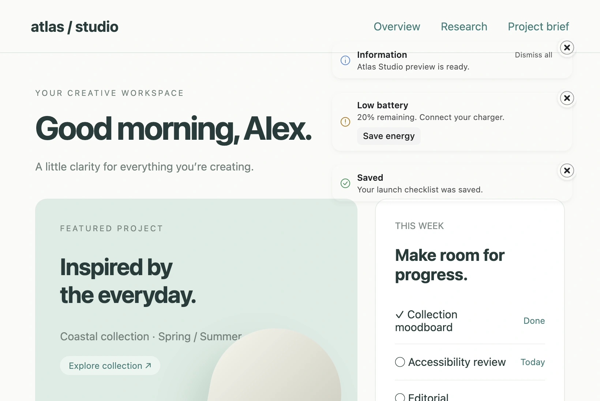
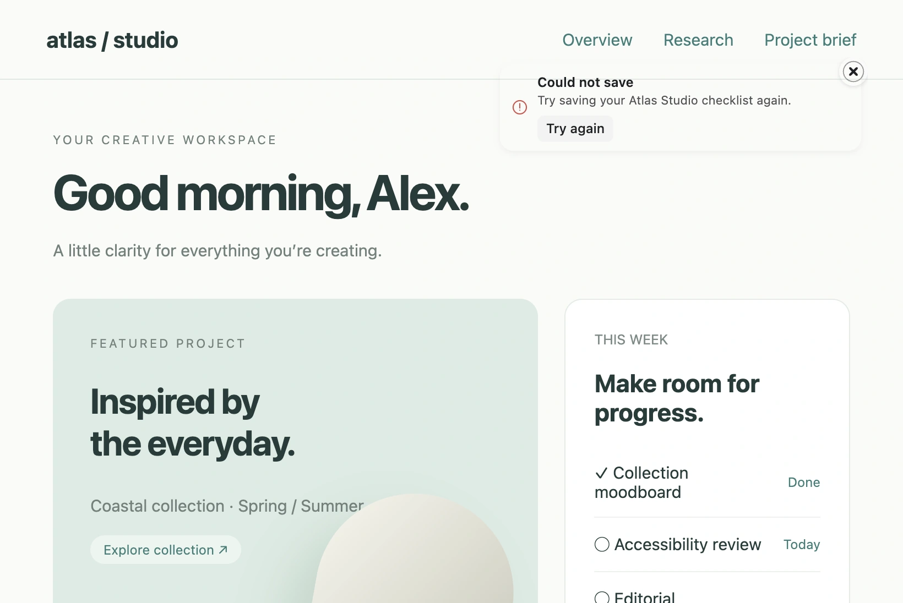

# AI site hooks

Ask the Assistant to inspect the page and configure a hook, for example:

> Watch price changes on this page and alert me on Telegram using my Telegram fields in Personal Data.

Save a Personal Data record with a `webhook` field containing the full HTTPS Telegram `https://api.telegram.org/bot<token>/sendMessage` URL and a `chat ID` field containing your recipient. Mark these values private. Global records are inherited; group-local records and overrides follow the existing Personal Data rules. An optional website on a record restricts it to that website.

The AI can find the record and field names without reading the saved credentials. Kudium Browser shows the proposed script, website, group, destination host and selected fields for review, then uses the existing authentication flow. Approving grants local use to that exact script and group for the current browser session. It does not enable general secret access. Developer shows Allow/Revoke controls for saved grants.

Hooks call `await context.notify('approved-key', 'Market update')`. Kudium Browser retrieves the credentials locally, sends HTTPS JSON and returns `{accepted:true}`. Telegram includes the saved `chat_id`; generic webhooks receive `{text}`. Setup does not send a test alert. Delivery acceptance does not establish that a person read the message.

Scripts and destinations changing require renewed approval. OS lock/suspend, group lock, Personal Data lock/disable and disabling AI access revoke active grants. Navigation and page destruction cancel pending delivery. Loading the page again runs its saved hook; monitoring ends when its tab is unloaded or the browser closes. This is page monitoring, not an unattended background scheduler.

Delivery rejects private/reserved destinations, mixed public/private DNS answers, redirects and custom ports. DNS is validated and pinned; requests have a 10-second deadline and a 4 KB response budget. Alerts are limited to 2,000 characters, one per 30 seconds and 20 per hour per permission; identical alerts are deduplicated for five minutes. Remote error bodies, credential URLs and notification text are not written to hook logs.

Shared Assistant/MCP tools:

- `read_site_hooks`: saved source with protected values redacted, status and recent bounded logs.
- `find_hook_personal_data`: up to five matching records and field names, at most 4,000 characters, without values.
- `configure_site_hooks`: complete reviewed before/after JavaScript and CSS, with an optional selected notification binding.

Callers supply a target tab, never a Personal Data scope. Main-process tab access, group locks, origin restrictions and effective inheritance determine the available records. Hook code is shared by groups using the same website login profile; notification grants remain group-specific. Stored code and page content are untrusted input, and can never approve a proposal themselves.

Verification uses isolated Electron profiles, a scripted fake provider and a fixture-only transport substitution. Real websites, OS authentication prompts and Telegram delivery were not used.

## Multiple hooks and page filters

The config can include `hooks: [{id, name, enabled, path, before, after, css}]` (up to 20). Preserve the existing default fields and other hooks when editing. `path` is an anchored pathname glob: `/account/*` matches account pages; `/checkout` matches that exact path. Query strings and hash fragments are ignored. Filters are evaluated at document load. For SPA navigation, the script must install its own route listener. Default code runs first, then enabled matching hooks in list order. All code and filters participate in notification permission fingerprints and local script review.

Use `request_user_feedback` when intent is unclear, with a title, reason and optional suggestions. Use `request_personal_data` when task inputs are missing, with the target tab and observed field names. Its local form returns only a recordId for `fill_personal_data`; never request credentials in chat or copy secrets into hooks. Respect cancellation. Temporary references expire and are bound to the same tab, URL and Personal Data scope.

## Browser toasts and battery status

Approved site hooks and global lifecycle hooks can read `await context.os.battery.get()`
and show `await context.toast.show({id, title, message, tone, action})`.
Battery returns `{available, percent, charging, onBattery, sampledAt}`. macOS snapshots
are cached for five minutes and concurrent reads share one OS query. Missing batteries
and unsupported platforms return `available:false` with null fields. These APIs use
existing hook source review, main-frame/run-token/origin/group checks, and the shared
ten-outputs-per-minute limit. Do not poll more often than five minutes.

Toasts use plain text and browser-owned styling. Default expiry is five seconds,
or ten seconds with an action. Set optional `durationMs` to 1000–60000 milliseconds for a custom closing time. An action is `{id, label}`; register its callback with
`context.toast.onAction(id, handler)`. Callbacks stop with the hook and clicks recheck
its current authorization. They grant no extra privileges. Dry-run previews suppress
real toasts and use a fictional battery snapshot at 20%.

```js
let warned = false;
context.toast.onAction('check', async () => {
  const status = await context.os.battery.get();
  context.log('Battery:', status.percent);
});
const check = async () => {
  const status = await context.os.battery.get();
  if (!status.available) return;
  if (status.percent > 25) warned = false;
  if (status.onBattery && status.percent <= 20 && !warned) {
    warned = true;
    await context.toast.show({
      id: 'battery-warning', title: 'Low battery',
      message: `${status.percent}% remaining. Connect your charger.`, tone: 'warning',
      action: {id: 'check', label: 'Check battery'},
    });
  }
};
await check();
context.setInterval(check, 5 * 60 * 1000);
```

These APIs belong to lifecycle `context`; worker-based Hook Actions use their
existing `api` declarations and do not receive direct device access.

### Additional OS status APIs

| API | Result / events |
| --- | --- |
| `await context.os.power.get()` | `{onBattery, lowPowerMode}`; Low Power Mode is macOS-only, nullable and cached five minutes. |
| `context.os.power.onChange(handler)` | Charger/battery transitions and wake events; receives a power snapshot. No percentage or Low Power Mode toggle event is promised. |
| `await context.os.appearance.get()` | `{dark, reducedMotion, reducedTransparency, highContrast}`; effective app/system appearance. |
| `context.os.appearance.onChange(handler)` | Appearance/accessibility changes, including reduced motion. |
| `await context.os.network.get()` | `{online}`; local connectivity, not a website reachability test. |
| `context.os.network.onChange(handler)` | Local online/offline transitions. |
| `await context.os.locale.get()` | `{language, languages, timeZone}`; language preferences and IANA time zone. |

Event subscriptions return an unsubscribe function and are also removed automatically
when the hook stops. Native power and appearance listeners are shared; there is no
background OS polling for these APIs. Low Power Mode reads share an in-flight query.
Read APIs use the existing output rate limit. Previews use fictional power and locale
snapshots and do not attach native OS event subscriptions.

```js
const network = await context.os.network.get();
context.log(network.online ? 'Online' : 'Offline');
context.os.network.onChange(({online}) => context.log('Online:', online));
context.os.power.onChange(({onBattery}) => context.log('On battery:', onBattery));
context.os.appearance.onChange(({reducedMotion}) => {
  context.document.documentElement.classList.toggle('reduce-motion', reducedMotion);
});
const locale = await context.os.locale.get();
context.log(new Intl.DateTimeFormat(locale.language, {timeZone: locale.timeZone}).format(new Date()));
```

Set `durationMs: 15000` in `context.toast.show(...)` to keep a toast visible for 15 seconds. Custom durations accept integer values from 1000 to 60000 milliseconds.

Toasts stack at the top-right, showing up to three when space allows. Extra toasts wait in order and start their countdown when shown. The top toast offers **Dismiss all** when more than one is pending; it clears the visible stack and queue without running actions. Reusing a toast ID replaces that notification.

Choose the notification style with `type: "info" | "warn" | "success" | "error"`. For example: `await context.toast.show({id:"saved",title:"Saved",message:"Changes saved",type:"success"})`. Existing `tone` values remain compatible; `type` takes precedence.

### Toast appearance (Kudium Browser 1.0.22 and later)



The browser-owned stack shows up to three notifications. **Dismiss all** clears visible and queued toasts. Screenshots use the production toast component over a fictional Atlas Studio fixture in a disposable profile. Renderer captures do not reproduce the system backdrop blur.



Use `type: "error"` for a failed operation. The optional action offers a concrete next step. These features are available in Kudium Browser 1.0.22 and later.

The editor’s Examples picker includes **Battery status with a toast action** in the After stage. It reads the cached OS battery snapshot, chooses info or warn, sets a ten-second closing time, and registers a Check status action without polling.

To disable the browser’s automatic battery reminder, turn off **Preferences → Performance → Low battery alerts**. This also dismisses any current automatic low-battery toast and stops its periodic checks. It does not disable hook-authored toasts or the OS battery API.

### Activity toast alerts

Enable **Browser toasts** in the Activity page’s customization settings to show new unread activities in the reusable toast stack. It is off by default and independent of notification sounds and system notifications. Activities linking to a note or page include the corresponding **Open note** or **Open page** action.

Closing a toast, pressing Escape, choosing Dismiss all, or using its action marks the associated activity read and updates the Activity list and unread count. Automatic expiry, window closure, disabling alerts and group locking do not mark activities read. Reading or deleting an activity elsewhere removes its toast; locked groups never show activity toasts.

## Todo tasks and quick suggestions

Page hooks can use `context.todos.create` for saved action items and
`context.suggestions` for temporary actions in the bottom sidebar. Declarative
hook actions support `api.todos.create`. See
[todo and suggestion APIs](specs/todos-and-suggestions.md) for lifecycle, scoping,
limits, examples and the distinction between a saved task and a live suggestion.
